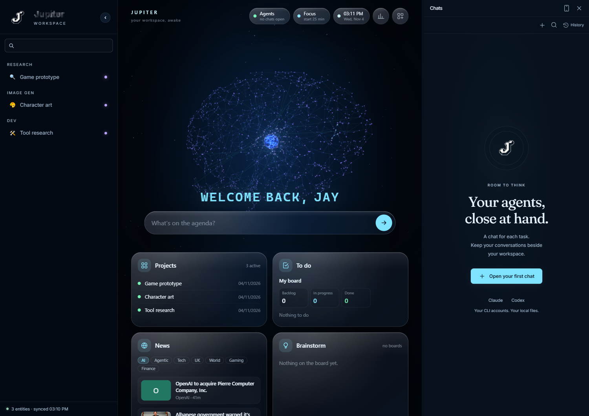
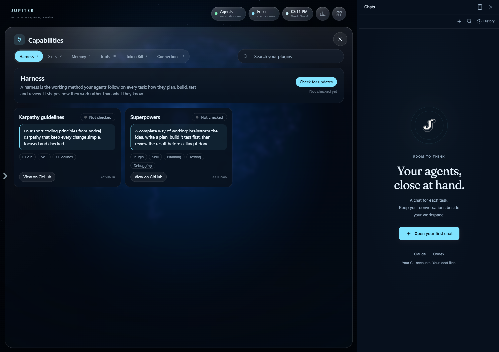
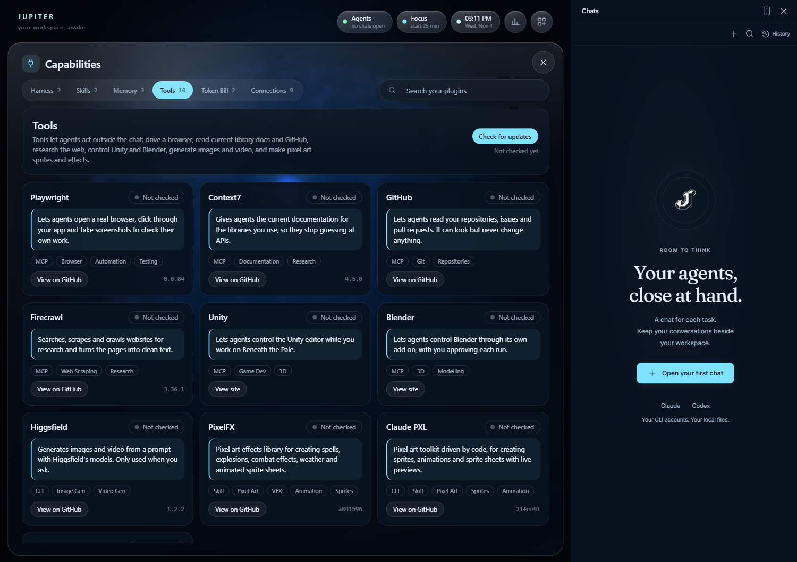
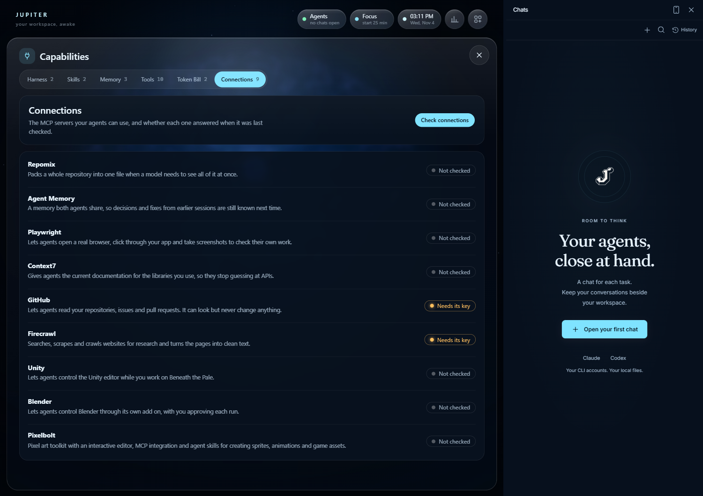

# Jupiter

A personal, local-first desktop workspace for working with AI coding agents. Jupiter puts a
live dashboard, Claude Code and Codex chats, project cards, a to-do board, a voice assistant
and a manager for the plugins, skills and MCP tools your agents use in one window. Everything
runs on your own PC, with your own CLI accounts.

Version 0.6.1 (beta) · Windows first · [Changelog](CHANGELOG.md)



## What it is

Jupiter is one desktop window with two halves:

- **Workspace** (left and centre) is where you see your work: a dashboard, project cards,
  reports, boards and files.
- **Chats** (right) is where you give tasks to **Claude Code** or **Codex**. Each chat is a real
  CLI terminal with its own tab and saved history.

It runs a small local service that listens on `127.0.0.1` only, and every request carries a
per-launch token. Nothing is sent anywhere unless you connect a service yourself. Jupiter does not
bundle the agent CLIs. It starts the ones you have installed and signed in to.

## Features

- **Dashboard.** Glass panels over an animated neural core: today's clock and focus timer, live
  agent status, **Projects**, a **To do** board, **News** by topic, **Brainstorm** boards and a
  **Token usage** chart. Everything shown is real data from your PC.
- **Ask Jupiter.** One bar that runs dashboard commands itself ("open my to do list", "show the
  news", "add *tune audio* to the board") and starts an agent chat for anything else. Pasted
  screenshots are saved to `inbox/attachments` and passed to the chat.
- **Agent chats.** Claude Code and Codex in real terminals, with a **Conversation | Terminal**
  switch, permission menus as buttons, slash-command autocomplete, project-aware **New chat**, tab
  groups, pinned tabs, searchable History, and **Summarize and continue** hand-offs for long chats.
- **Project cards and reports.** Cards for research, image work, dev notes and more. Edit them
  yourself (images, notes, prompts, source links) or let an agent edit the same files. See
  [editable cards](docs/editable-cards.md).
- **To do board and Brainstorm.** A Backlog / In progress / Done board with a calendar and weekly
  summary, and a freeform board with sticky notes, shapes, a pen and a highlighter. Both are plain
  JSON and Markdown in `knowledge/`.
- **Voice (optional).** The round **J** button listens for one request, or say "Hey Jupiter".
  Listening uses local Whisper, so nothing is recorded or sent until it hears you. Replies are
  spoken in a voice you choose, with a saved bank of short phrases. See [voice setup](#optional-voice-and-keys).
- **Capabilities manager.** Review, install, update and remove plugins, skills and MCP tools from
  one place. See [Plugins, tools and MCP connections](#plugins-tools-and-mcp-connections).
- **On your phone.** Read chats, send follow-ups and dictate messages from a mobile web app over
  Tailscale while your agents keep running on the computer. See [mobile access](docs/mobile-access.md).
- **Themes.** Separate Workspace and Chat themes, including Claude Code, Codex and several light
  and dark palettes, under **Settings → Appearance**.
- **Your files, close at hand.** A file tree for `inbox`, `projects`, `workspace`, `knowledge` and
  `processes`, with Markdown preview and edit.

## Plugins, tools and MCP connections

Open **Plugins** or **MCP** in the left rail (hover the left edge and click the arrow), or ask
Jupiter to "show my capabilities". The Capabilities view groups everything that is installed:

| Tab | What it holds |
| --- | --- |
| **Harness** | The working method your agents follow: Karpathy guidelines, Superpowers |
| **Skills** | Anthropic document skills (docx, pdf, pptx, xlsx), UI UX Pro Max |
| **Memory** | Agent Memory (shared by both agents), Repomix, Graphify |
| **Tools** | Playwright, Context7, GitHub, Firecrawl, Unity, Blender, Higgsfield, PixelFX, Claude PXL, Pixelbolt |
| **Token Bill** | Caveman (terse replies), Claude HUD (status line) |
| **Connections** | Every MCP server your agents can use, and whether it answered |





### MCP connections

The **Connections** tab lists each MCP server (Repomix, Agent Memory, Playwright, Context7,
GitHub, Firecrawl, Unity, Blender, Pixelbolt) with a plain-English description and a status.
**Check connections** tests each one on demand. A server that needs a key shows **Needs its key**.
Jupiter reads MCP configuration across Claude Code, Codex, Kimi, Cursor and Antigravity for the
workspace and your recent projects, and never shows credential values.



### How installs work

Installs are reviewed and pinned before anything runs:

1. **Review** pins the latest commit or package version. For a repository it fetches exactly that
   commit with git hooks disabled, then lists its hooks, MCP servers, skills, commands and install
   scripts.
2. **Install** runs only with that review's one-time token (valid for 30 minutes). Hooks need a
   tick to confirm you have read them. If a step fails, what already ran is rolled back.
3. Plugins go through Claude Code's and Codex's own mechanisms, MCP servers through
   `claude mcp add` and `codex mcp add` with a pinned version, and skills are copied to
   `~/.claude/skills` and `~/.agents/skills`. MCP tools can be switched on everywhere or per project.
4. Every install is recorded in [`knowledge/capabilities.lock.json`](knowledge/capabilities.lock.json).
   **Remove** undoes exactly what Jupiter recorded and never touches anything it did not add.
5. **Check for updates** compares each item with its latest GitHub commit or npm/PyPI version
   (green, orange or red). Clicking an orange item reviews and updates it in place.

Keys are recorded by variable name only, for example `GITHUB_PAT_TOKEN` for the read-only GitHub
server. The catalogue of available picks is [`knowledge/capabilities.json`](knowledge/capabilities.json).

## Install

Jupiter is built from source. These steps are for Windows 10 or 11 (x64).

### 1. Prerequisites

- [Git](https://git-scm.com/downloads)
- [Node.js](https://nodejs.org) **22.20 or newer**
- [Rust](https://rustup.rs) (stable) and the **Visual Studio C++ Build Tools** (the "Desktop
  development with C++" workload). Needed only to compile the desktop app.
- WebView2, which ships with Windows 11 and current Windows 10.
- **At least one agent CLI**, installed and signed in with your own account:
  - [Claude Code](https://code.claude.com/docs/en/setup) (a Claude Pro or Max login works)
  - [Codex CLI](https://developers.openai.com/codex/cli) (a ChatGPT subscription login works)
- Optional: Python 3 for local Whisper (wake word, dictation, read aloud), and
  [Tailscale](https://tailscale.com) for phone access.

You do not need an API key to chat. Jupiter runs the real CLI with its existing login.

### 2. Get the code

```powershell
git clone https://github.com/JayMackay/jupiter-lite.git
cd jupiter-lite
```

The repository is private, so sign in first with `gh auth login` or a Git credential.

### 3. Check, then build

```powershell
powershell -ExecutionPolicy Bypass -File .\Setup.ps1 -Mode Check
powershell -ExecutionPolicy Bypass -File .\Setup.ps1 -Mode Desktop
```

`-Mode Check` reports which prerequisites are missing. `-Mode Desktop` installs dependencies
(`npm ci`) and builds the app plus a Windows installer in `src-tauri\target\release\bundle\nsis`;
the first build takes several minutes. Run the installer, then continue to step 4.

To skip the installer and build just `jupiter.exe`, which **Start Jupiter.cmd** launches directly:

```powershell
npm ci
npm run desktop:build -- --no-bundle
```

### 4. Start Jupiter

Double-click **Start Jupiter.cmd** (or run `Start Jupiter.ps1`). It opens the app on this folder.
In Chats, press **+**, choose Claude or Codex and pick a working folder. The first time, the CLI
asks you to sign in.

After you change the interface or the service, rebuild with
`npm run desktop:build -- --no-bundle` and restart Jupiter. The app runs its own copy of both.

### Optional: voice and keys

Copy `.env.example` to `.env` and add only what you use. `.env` is git-ignored, so keep keys there
and never commit them.

| Variable | Used for |
| --- | --- |
| `ELEVENLABS_API_KEY`, `ELEVENLABS_VOICE_ID` | Spoken replies |
| `OPENAI_API_KEY` | The OpenAI Live voice connection (billed separately from a CLI subscription) |
| `OPENROUTER_API_KEY` | Optional cloud dictation |
| `FAL_KEY` | Optional fal.ai image and video generation |
| `JUPITER_COORDINATOR_MODEL` | Override the model the voice coordinator uses |

The voice coordinator uses your signed-in **Codex** CLI. For local dictation, follow
[voice dictation](knowledge/voice-dictation.md). The wake word needs the optional Python setup.

### Optional: phone access

Enable mobile access from the phone button in Chats, scan the QR code and confirm the matching
code on the desktop. Both devices need Tailscale. Full steps are in [mobile access](docs/mobile-access.md).

### Browser preview and tests

```powershell
npm run dev            # UI only, http://localhost:3009 (features that need the desktop app say so)
npm test               # service tests
npm run desktop:test:ui  # browser UI tests (Playwright, Microsoft Edge)
npm run test:template  # repository and skills checks
```

The Linux and macOS build scripts are `setup.sh` and [docs/macos.md](docs/macos.md). Jupiter
itself is developed and used on Windows.

## Project layout

| Folder | Holds |
| --- | --- |
| `src/` | The React interface (dashboard, chats, capabilities, cards) |
| `desktop/service/` | The local Node service: chats, voice, MCP, capabilities, news |
| `src-tauri/` | The Tauri desktop shell that builds `jupiter.exe` |
| `workspace/` | Cards and reports, registered in `workspace/workspace.json` |
| `knowledge/` | To-do and brainstorm boards, voice clips, the capabilities catalogue and lock |
| `context/`, `processes/`, `inbox/` | Your preferences, saved workflows and incoming files |
| `.agents/skills/`, `.claude/skills/` | Project skills (edit the first, then `npm run skills:sync`) |
| `docs/` | Guides: [customization](docs/customization.md), [skills](docs/skills.md), [updating](docs/updating.md) |

Repository rules for agents are in [AGENTS.md](AGENTS.md). Project notes are in
[JUPITER.md](JUPITER.md).

## Licence

Copyright (c) 2026 JayMackay. All rights reserved. See [LICENSE](LICENSE).

Open-source components keep their own licences, listed in
[THIRD_PARTY_NOTICES.md](THIRD_PARTY_NOTICES.md).

Application code and original documentation are under the [MIT licence](LICENSE).
